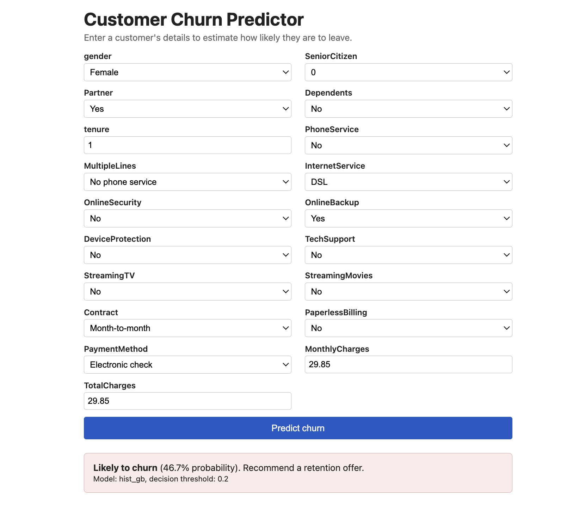
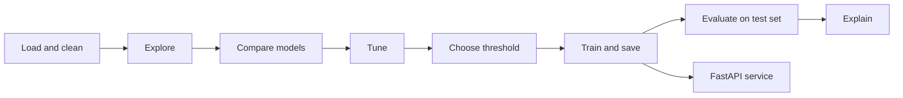
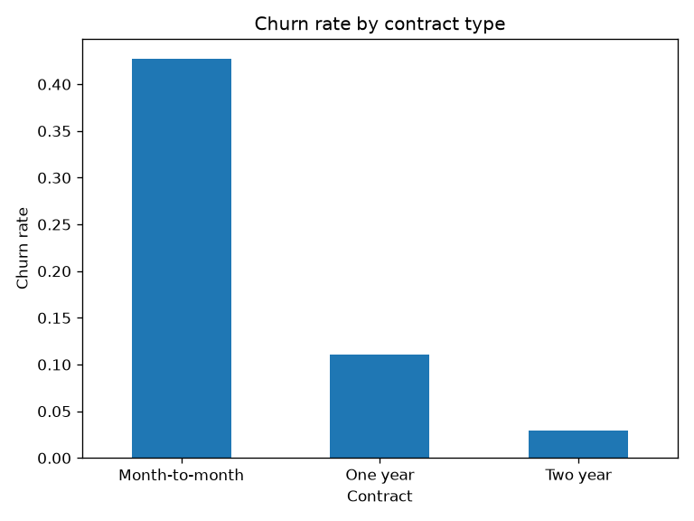
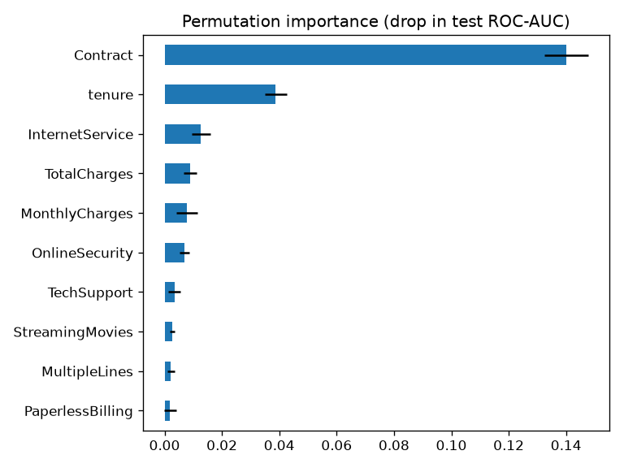

# Customer Churn Prediction

Predicts which telecom customers are likely to cancel, chooses who to contact based on business costs, and serves predictions through a tested FastAPI service with a simple web interface.



## Results

Evaluated once on 1,409 held-out customers that were never used for training or any modeling decision.

| Measure | Result |
| --- | --- |
| ROC-AUC | 0.846 |
| Churners caught (recall) at the chosen threshold | 86.4% (323 of 374) |
| Churners caught at the default 0.5 threshold | 50.8% |
| Precision at the chosen threshold | 49.0% |
| Estimated cost of churn with no model | $187,000 |
| Estimated cost of churn with the model | $139,200 |

The model catches 86% of churners and cuts the estimated cost of churn by about 26%. It does this with **lower accuracy than predicting "no churn" for everyone** (72.5% vs 73.5%), because it deliberately accepts false alarms to catch more churners. That trade is the right one when a missed churner costs ten times more than a retention offer, and it is why accuracy was not used to judge the model.

## The problem

A telecom company loses about 26.5% of its customers. The retention team can contact at-risk customers with an offer, but each offer costs money. The question is:

> Which customers should the retention team contact?

This is binary classification. The model outputs a churn probability, and a threshold turns it into a contact or no-contact decision.

**Business assumptions** (placeholders, set in `churn/config.py`):

| Assumption | Value |
| --- | --- |
| Cost of one retention offer | $50 |
| Revenue lost when a customer churns | $500 |
| Share of contacted churners the offer keeps | 50% |

## Data

[IBM Telco Customer Churn](https://github.com/IBM/telco-customer-churn-on-icp4d): 7,043 customers and 21 columns describing demographics, contract, services, billing and whether the customer left.

- **Label:** `Churn` (26.5% Yes)
- **Features:** 19 columns, 3 numeric (`tenure`, `MonthlyCharges`, `TotalCharges`) and 16 categorical
- **Dropped:** `customerID`

## Approach



1. **Cleaning.** `TotalCharges` loads as text because 11 rows contain a blank. All 11 are customers with zero tenure who have not been billed yet, so they were filled with 0, not the median. `Churn` was mapped to 1/0 and `customerID` dropped.
2. **Fixed split.** One stratified 80/20 split with a fixed seed. Every modeling decision uses only the training set.
3. **Model comparison.** A baseline, logistic regression, random forest and histogram gradient boosting were compared with stratified 5-fold cross-validation, using one scikit-learn `Pipeline` per model so preprocessing is learned inside each fold.
4. **Tuning.** Grid search for logistic regression and randomized search (30 combinations) for gradient boosting.
5. **Threshold from costs.** Out-of-fold probabilities on the training set were used to find the threshold with the lowest total business cost.
6. **Final training and evaluation.** The chosen pipeline was trained on the full training set, saved with its threshold, and evaluated once on the test set.
7. **Explanation.** Permutation importance on the test set.

### Model comparison (5-fold cross-validation)

| Model | ROC-AUC | PR-AUC | Recall at 0.5 |
| --- | --- | --- | --- |
| Logistic regression | 0.846 | 0.661 | 0.544 |
| Random forest | 0.845 | 0.659 | 0.497 |
| Gradient boosting (untuned) | 0.836 | 0.647 | 0.512 |
| Gradient boosting (tuned) | 0.847 | | |
| Baseline (predicts the churn rate) | 0.500 | 0.265 | 0.000 |

Tuned gradient boosting and logistic regression performed equally well, within cross-validation noise. Gradient boosting was kept. Logistic regression would be a reasonable alternative where exact per-feature weights are needed.

### Why the threshold is 0.2

Contacting a customer with churn probability p costs $50 and saves, on average, p × 50% × $500 = p × $250. That is worth it when p > 0.2. The cost search on out-of-fold predictions arrived at the same value.

| Threshold | Recall | Precision | Estimated cost (training set) |
| --- | --- | --- | --- |
| 0.2 (chosen) | 0.859 | 0.479 | $560,600 |
| 0.5 (default) | 0.511 | 0.671 | $613,450 |
| No model | 0.000 | | $747,500 |

## Key findings



| Driver | Evidence |
| --- | --- |
| Contract type | Month-to-month customers churn at 42.7%, two-year customers at 2.9%. Most important feature by far. |
| Tenure | 52% of customers in their first 6 months churn, vs 10% after 4 years |
| Internet service | Fiber optic customers churn at 42%, vs 19% for DSL |
| Payment method | Electronic check payers churn at 46%, vs 15% to 16% for automatic payments |



Permutation importance confirms contract and tenure as the main drivers. Gender has no measurable effect.

**Suggested actions to test:** incentives to move month-to-month customers to annual contracts, stronger onboarding in the first six months, and a review of fiber pricing and service quality. Importance shows association, not cause, so these should be validated with experiments.

## API

| Endpoint | Purpose |
| --- | --- |
| `GET /` | Web form for single predictions |
| `POST /predict` | Churn probability and decision for one customer |
| `GET /health` | Liveness check, including whether the model is loaded |
| `GET /model` | Model name, threshold, settings and training time |
| `GET /docs` | Interactive API documentation |

Example:

```bash
curl -X POST http://127.0.0.1:8000/predict \
  -H "Content-Type: application/json" \
  -d '{"gender":"Female","SeniorCitizen":0,"Partner":"Yes","Dependents":"No","tenure":1,"PhoneService":"No","MultipleLines":"No phone service","InternetService":"DSL","OnlineSecurity":"No","OnlineBackup":"Yes","DeviceProtection":"No","TechSupport":"No","StreamingTV":"No","StreamingMovies":"No","Contract":"Month-to-month","PaperlessBilling":"Yes","PaymentMethod":"Electronic check","MonthlyCharges":29.85,"TotalCharges":29.85}'
```

```json
{"churn_probability": 0.6576, "will_churn": true, "threshold": 0.2, "model": "hist_gb"}
```

**Engineering details**

- Input is validated with Pydantic. Categorical fields accept only the values seen in training, so a typo returns a 422 error instead of a silent bad prediction.
- The model bundle (pipeline, threshold and metadata) is loaded once at startup.
- The web form is generated from the Pydantic model, so the form and the validation always agree.
- Every request is logged with a request ID (also returned in the `X-Request-ID` header), status code and duration. Predictions are logged without customer details.

## Project structure

```
customer-churn-prediction/
  churn/
    config.py        paths, columns, business assumptions
    data.py          load, clean, split
    eda.py           exploration and charts
    features.py      preprocessing
    models.py        model builders
    compare.py       cross-validated comparison
    tune.py          hyperparameter search
    threshold.py     cost-based threshold
    train.py         final training and saving
    evaluate.py      test set evaluation
    explain.py       permutation importance
  app/
    main.py          FastAPI service
    templates/       web form
  tests/             pytest suite
  reports/           metrics, tables and charts
  Dockerfile
```

## Run it

```bash
git clone https://github.com/<your-username>/customer-churn-prediction.git
cd customer-churn-prediction
python3 -m venv .venv
source .venv/bin/activate
pip install -r requirements.txt

mkdir -p data/raw
curl -L -o data/raw/Telco-Customer-Churn.csv https://raw.githubusercontent.com/IBM/telco-customer-churn-on-icp4d/master/data/Telco-Customer-Churn.csv
```

Run the pipeline in order (about two minutes on a laptop CPU):

```bash
python -m churn.data
python -m churn.eda
python -m churn.compare
python -m churn.tune
python -m churn.threshold
python -m churn.train
python -m churn.evaluate
python -m churn.explain
```

Run the tests and start the service:

```bash
python -m pytest
fastapi dev app/main.py
```

Open http://127.0.0.1:8000 for the web form or http://127.0.0.1:8000/docs for the API.

### With Docker

After training the model:

```bash
docker build -t churn-api .
docker run -p 8000:80 churn-api
```

## Tests

16 tests cover data cleaning, prediction logic, input validation, request IDs, logging, the web page and an end-to-end prediction with the real model. API tests replace the model with a fake through FastAPI dependency overrides, so they check the service logic independently of model output.

## Limitations and next steps

- The business costs are assumptions. Real figures would change the threshold, but not the model.
- The data is a single snapshot, so the model cannot use how a customer's behavior changes over time.
- Feature importance shows association, not cause.
- In production: retrain on a schedule, monitor input distributions and the flagged rate for drift, and A/B test whether retention offers actually reduce churn.

## Tech stack

Python, pandas, scikit-learn, FastAPI, Pydantic, Jinja2, pytest, Docker